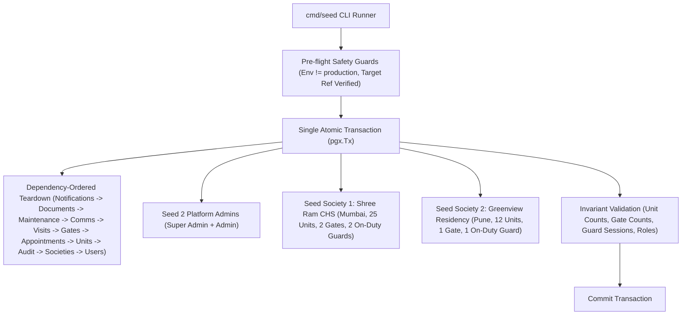

# 13 — Development Seed Data and Reset Architecture

## Purpose
Specifies the operational rules, data distribution, and repeatable execution harness for resetting the development database to a pristine, realistic baseline covering all completed sprints (S00–S08) prior to beginning S09 (Gate Operations).

---

## Architecture & Boundaries

---

## 1. Safety Controls

1. **Environment Gate**:
   `cfg.Env != "production"` checked at startup. Any attempt to run against a production-configured environment immediately exits with fatal error.
2. **Explicit Confirmation**:
   The command requires flag `--confirm-dev-reset`. Bare invocations display the intended destructive scope and abort.
3. **Target Validation**:
   Checks database host / credentials against expected Supabase development project ref (`glpjpqpbhdcmgmwlnkay`).
4. **Schema & Migration Protection**:
   `schema_migrations`, tables, functions, triggers, and reference catalogues (`society_suspension_reasons`) are strictly preserved.
5. **Atomic Execution**:
   All deletions, insertions, and integrity checks are contained in a single `pgx.Tx`. Any failure triggers an automatic rollback.
6. **Immutability Trigger Handling**:
   Financial and document version immutability triggers (`trg_bill_items_immutable`, `trg_document_versions_immutable`, and `platform_audit_logs_immutability_trg`) are safely disabled within the local teardown transaction before deleting dependent records, and immediately re-enabled.

---

## 2. Platform Administration Baseline

| Identity | Normalized Phone | Platform Role | Status | Created By | Description |
| :--- | :--- | :--- | :--- | :--- | :--- |
| **Super Admin** | `919967089101` (`+919967089101`) | `SUPER_ADMIN` | `ACTIVE` | `NULL` | Root platform administrator with full governance access |
| **Platform Admin** | `918422862001` (`+918422862001`) | `ADMIN` | `ACTIVE` | Super Admin | Operational platform administrator (read/manage societies) |

---

## 3. Society Topology & Demographics

### Society 1: Shree Ram Cooperative Housing Society
- **Location**: Mumbai, Maharashtra, India (`SOC-MUM-XXXXXX`, Pincode `400001`)
- **Status**: `ACTIVE`
- **Structure**:
  - Building: Building A (`BLD-A`, 5 Floors)
  - Wing: Wing A (`WING-A`, 5 Floors)
  - Units: Exactly 25 units (`A-101` through `A-505`, 5 units/floor)
  - Gates: Exactly 2 gates:
    - `GATE-01`: Main Gate (`BIDIRECTIONAL`, `ACTIVE`, Req. Staff: 1)
    - `GATE-02`: Service Gate (`BIDIRECTIONAL`, `ACTIVE`, Req. Staff: 1)
  - Shifts: Morning (06:00–14:00), Afternoon (14:00–22:00), Night (22:00–06:00)
  - Security Staff: 2 active gatekeepers:
    - Ramesh Shinde (`919820010001`): Stationed on active duty at Main Gate
    - Suresh Patil (`919820010002`): Stationed on active duty at Service Gate
  - Governance Appointments:
    - Chairman: Rajesh Sharma (`A-101`)
    - Secretary: Vikram Deshmukh (`A-102`)
    - Treasurer: Amit Kulkarni (`A-103`)
    - Committee Members: Priya Nair (`A-104`), Anand Joshi (`A-105`)
  - Household Occupancy:
    - 18 owner-occupied units (72%)
    - 4 tenant-occupied units (16%)
    - 3 vacant units (12%: `A-205`, `A-305`, `A-405`)

### Society 2: Greenview Residency
- **Location**: Pune, Maharashtra, India (`SOC-PUN-XXXXXX`, Pincode `411001`)
- **Status**: `ACTIVE`
- **Structure**:
  - Building: Building 1 (`BLD-1`, 3 Floors)
  - Wing: Wing 1 (`WING-1`, 3 Floors)
  - Units: Exactly 12 units (`101` through `304`, 4 units/floor)
  - Gates: Exactly 1 gate:
    - `GATE-01`: Main Gate (`BIDIRECTIONAL`, `ACTIVE`, Req. Staff: 1)
  - Shifts: General Shift (08:00–20:00), Night Shift (20:00–08:00)
  - Security Staff: 1 active gatekeeper:
    - Deepak Jadhav (`919820020001`): Stationed on active duty at Main Gate
  - Governance Appointments:
    - Chairman: Vijay Godbole (`101`)
    - Secretary: Milind Date (`102`)
    - Treasurer: Sudhir Apte (`103`)
    - Committee Member: Rekha Chitnis (`104`)
  - Household Occupancy:
    - 8 owner-occupied units (67%)
    - 3 tenant-occupied units (25%)
    - 1 vacant unit (8%: `204`)

---

## 4. Verification Invariants

Upon completion of the seed command, the following invariants are asserted:
1. `users` count = 5 (Super Admin + Platform Admin + 3 Gatekeepers).
2. `platform_roles` count = 2 (1 `SUPER_ADMIN`, 1 `ADMIN`).
3. `societies` count = 2 (Both `ACTIVE`).
4. `society_units` count = 37 (25 for Society 1, 12 for Society 2).
5. `society_gates` count = 3 (2 for Society 1, 1 for Society 2).
6. `society_gate_sessions` count = 3 (All `status = 'ACTIVE'`, 0 duplicate guards).
7. `society_suspension_reasons` = 8 (Pre-existing canonical reference data unchanged).
8. `visitor` tables = None seeded (Preserved for S09).

---

## Related Documentation
- [[../decisions/021-development-database-reset-and-seed|ADR 021: Development Database Reset and Controlled Demo Data Seeding]]
- [[../decisions/020-gate-foundation-and-staffing-operations|ADR 020: Gate Foundation, Gatekeeper Roles, and Staffing Operations]]
- [[../sprints/S08-gate-foundation|S08 — Gate Foundation]]
