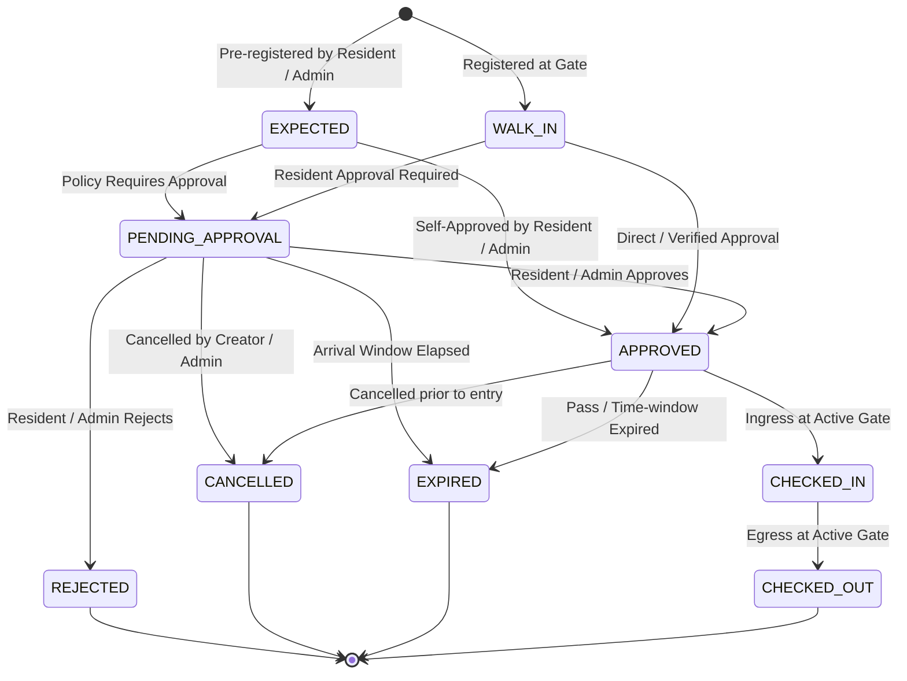

# 14 — Gate Visitor Operations Architecture

## Overview
Sprint S09 extends the perimeter security infrastructure established in S08 ([[12-gate-foundation-and-staffing]]) by delivering an operational, real-time visitor-management system. It enables residential societies to govern expected visits, walk-in arrivals, resident approvals, time-bound visitor passes, and atomic gate ingress/egress.

## Architectural Topology

```text
+-----------------------------------------------------------------------------------+
|                                  Frontend UI                                      |
|  [Society Shell] -> [Gate Console] -> [Terminal / Visitors / Approvals / History] |
+-----------------------------------------------------------------------------------+
                                        |  HTTPS (Bearer JWT + X-Session-ID)
                                        v
+-----------------------------------------------------------------------------------+
|                                Go Chi Backend                                     |
|  - Auth Middleware (JWT + Stateful Session)                                       |
|  - Tenant Scoping & Role Validation (SOC_ADMIN, GATEKEEPER, Resident Occupant)    |
|  - Gatekeeper Duty Session Enforcement                                            |
|  - Visitor Domain Service (State Machine, Pass Hashing, Atomic Entry/Exit)        |
+-----------------------------------------------------------------------------------+
                                        |  pgx Pool / Transactions
                                        v
+-----------------------------------------------------------------------------------+
|                         PostgreSQL (Hosted on Supabase)                           |
|  - society_visits (Lifecycle State Machine & Invariant Constraints)               |
|  - society_visitor_passes (Hashed Bearer Tokens & Short Pass Codes)               |
|  - society_visit_approvals (Resident & Admin Approval Ledger)                     |
|  - society_gate_events (Append-Only Physical Movement Ledger)                     |
|  - platform_audit_logs (Transactional Audit Trail)                                |
+-----------------------------------------------------------------------------------+
```

## Core Domain Concepts

### 1. Visitor Identity Without Global User Accounts
A visitor is an external party requesting temporary entry. To adhere to privacy and security requirements:
- No record is created in the global `users` table.
- No OTP or application installation is required for visitors.
- Personal information is minimized: visitor name and normalized phone number only.
- Vehicle registration number is captured optionally where applicable.

### 2. Visit Lifecycle State Machine



#### Valid Transition Matrix
| From State | Allowed Target State | Permitted Actor | Validation Rules |
| :--- | :--- | :--- | :--- |
| `PENDING_APPROVAL` | `APPROVED` | Resident of Unit or `SOC_ADMIN` | Visit must belong to target unit & society. |
| `PENDING_APPROVAL` | `REJECTED` | Resident of Unit or `SOC_ADMIN` | Optional rejection reason recorded. |
| `PENDING_APPROVAL` | `CANCELLED` | Creator or `SOC_ADMIN` | Prior to arrival. |
| `APPROVED` | `CHECKED_IN` | Gatekeeper with Active Duty Session | Gate active & ingress allowed; pass valid if used. |
| `APPROVED` | `CANCELLED` | Creator or `SOC_ADMIN` | Prior to entry. |
| `APPROVED` | `EXPIRED` | System / Gatekeeper / Evaluator | Expiry time has passed. |
| `CHECKED_IN` | `CHECKED_OUT` | Gatekeeper with Active Duty Session | Gate active & egress allowed. |

### 3. Resident Approval Model and Unit Policy
1. **Persistent Unit Policy (`society_units.requires_visitor_approval`)**:
   - Each residential unit holds a persistent approval preference, defaulted to `false` (OFF).
   - Only authorized residents of the unit (active occupants or owners linked via `unit_relationships`) can read and toggle their unit's preference.
   - Gatekeepers and society administrators cannot toggle or override the unit's approval policy.
2. **Server-Side Policy Resolution**:
   - Upon walk-in registration, the backend server resolves `requires_visitor_approval` directly from `society_units` for the destination `unit_id`.
   - If `false`, the visit transitions directly to `APPROVED`, ready for gate check-in.
   - If `true`, the visit is placed into `PENDING_APPROVAL`, awaiting resident action.
3. **Unit-Level Resident Authorization**:
   - Authorized occupants of the unit (`unit_relationships` with `is_occupant = true` or `relationship_type IN ('PRIMARY_OWNER', 'SECONDARY_OWNER')`) can inspect pending approval visits for their unit and submit `APPROVED` or `REJECTED`.
   - Cross-unit approval attempts (e.g. resident of Flat 101 attempting to approve Flat 202) are rejected with HTTP 403 Forbidden (`OCCUPANT_UNAUTHORIZED`).
   - Gatekeepers cannot approve or reject visits (`403 Forbidden`).
   - Society administrators (`SOC_ADMIN`) retain administrative authority to approve/reject on behalf of residents in emergency scenarios, fully recorded in audit logs.
   - Rejection strictly locks the visit from check-in.

### 4. Pass Generation and Verification
- **Bearer Token**: High-entropy 32-byte cryptographically secure random token formatted as `chs_pass_<64_hex_chars>`.
- **Hashed Storage**: Only `SHA256(token)` is stored in `society_visitor_passes.token_hash`.
- **Pass Code**: A 6-character alphanumeric code (e.g. `GP-8492`) is generated for manual entry at the gate terminal.
- **Verification**: Verifies that the pass is `ACTIVE`, current timestamp is between `valid_from` and `valid_until`, and associated visit is `APPROVED`.
- **Consumption**: Upon check-in, single-use passes are transitioned to `CONSUMED`.

### 5. Gatekeeper Duty Integration
Gate operations (check-in and check-out) require the operator to be an assigned gatekeeper (`society_user_roles.role = 'GATEKEEPER'`) or `SOC_ADMIN` holding an active duty session (`society_gate_sessions`) at the designated gate. This guarantees personal operational accountability for every vehicle and pedestrian crossing the perimeter.

### 6. Atomic Concurrency Control
Check-in and check-out operations acquire a row lock on `society_visits` (`SELECT ... FOR UPDATE`).
- If another gatekeeper or process concurrently submits a check-in for the same visit, the losing transaction evaluates the updated status (`CHECKED_IN`) and returns HTTP 409 Conflict with code `VISIT_ALREADY_CHECKED_IN`.
- Duplicate physical entries are structurally impossible.

## Related Documents
- [[12-gate-foundation-and-staffing]]
- [[../decisions/023-visitor-lifecycle-and-gate-operations]]
- [[../database/09-gate-visitor-operations-schema]]
- [[../api/10-gate-visitor-operations-api]]
- [[../security/09-gate-visitor-operations-security]]
