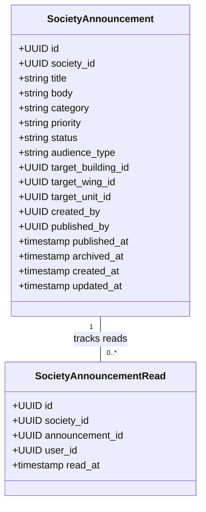
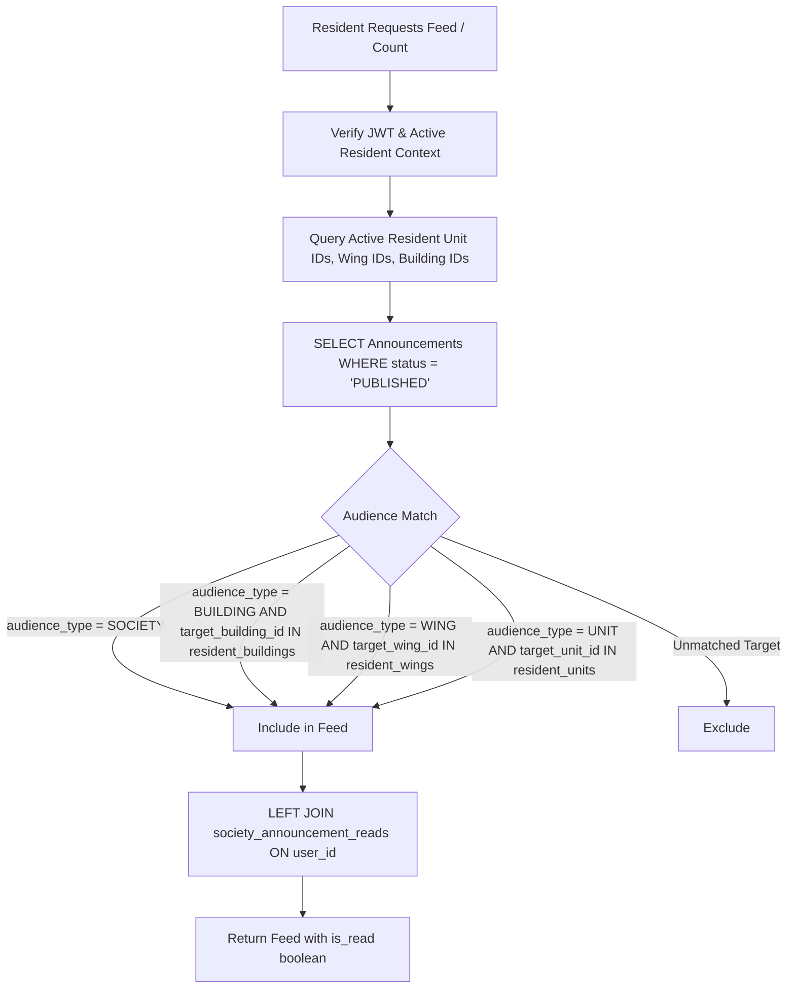

# 15 — Society Communication Architecture

## Overview
The Society Communication system (Sprint S10) provides an official, verifiable bulletin and notice broadcasting infrastructure for cooperative housing societies. It enables managing committees and authorized society administrators (`SOC_ADMIN`) to draft, publish, and archive notices, while providing occupants (`RESIDENT`) with a personalized, chronological announcement feed with read/unread tracking.

---

## 1. Domain Entities & Architecture



### 1.1 Category & Priority Taxonomy
- **Categories**: `GENERAL`, `MAINTENANCE`, `SECURITY`, `EVENT`, `EMERGENCY`, `ADMINISTRATIVE`.
- **Priority**: `NORMAL`, `URGENT`, `CRITICAL`.
  - `CRITICAL` announcements trigger high-visibility alerts on resident dashboards.

---

## 2. Audience Resolution Engine



### 2.1 Resolution Logic
1. System resolves all active units associated with the authenticated user via:
   ```sql
   SELECT u.id as unit_id, u.wing_id, u.building_id
   FROM unit_relationships ur
   JOIN society_members sm ON ur.member_id = sm.id
   JOIN society_units u ON ur.unit_id = u.id
   WHERE sm.user_id = $userID 
     AND sm.society_id = $societyID 
     AND ur.status = 'ACTIVE' 
     AND sm.status = 'ACTIVE';
   ```
2. Announcements are selected where `society_id = $societyID` AND `status = 'PUBLISHED'` AND:
   - `audience_type = 'SOCIETY'`, OR
   - (`audience_type = 'BUILDING'` AND `target_building_id = ANY($buildingIDs)`), OR
   - (`audience_type = 'WING'` AND `target_wing_id = ANY($wingIDs)`), OR
   - (`audience_type = 'UNIT'` AND `target_unit_id = ANY($unitIDs)`).
3. Draft and Archived announcements are filtered out server-side.

---

## 3. Read Tracking & Unread Counts

1. **Mark as Read**: Idempotent endpoint `POST /societies/{id}/announcements/{announcementId}/read`:
   - Validates user belongs to society and has authorization to view the announcement.
   - Executes `INSERT INTO society_announcement_reads (society_id, announcement_id, user_id) VALUES ($1, $2, $3) ON CONFLICT (announcement_id, user_id) DO NOTHING`.
2. **Unread Count**: `GET /societies/{id}/announcements/unread-count`:
   - Runs a fast indexed `COUNT(*)` over visible published announcements where `read_at IS NULL`.
   - Used for badge counters in the top navigation shell and society menu drawer.

---

## 4. Audit Logging & Non-Repudiation

Privileged mutations emit transactional records to `platform_audit_logs`:
- `ANNOUNCEMENT_CREATED`: Logged upon draft creation.
- `ANNOUNCEMENT_UPDATED`: Logged when title, body, category, priority, or targets change.
- `ANNOUNCEMENT_PUBLISHED`: Logged when transitioning from DRAFT to PUBLISHED.
- `ANNOUNCEMENT_ARCHIVED`: Logged when transitioning from PUBLISHED to ARCHIVED.

If audit logging fails, the transaction rolls back, preserving fail-closed system integrity.

---

## 5. Related Documentation
- [[../decisions/024-society-communication-and-announcements|ADR 024: Society Communication]]
- [[../database/10-society-communication-schema|Database Schema 10: Society Communication Schema]]
- [[../api/11-society-communication-api|API 11: Society Communication API]]
- [[../security/10-society-communication-security|Security 10: Society Communication Security]]
- [[../sprints/S10-society-communication|S10 Sprint Specification]]
