# 17. Maintenance Operations & Collections Architecture

## 1. Domain Overview
Sprint S12 extends the maintenance financial domain to handle collections, allocations, receipting, and balance tracking while strictly preserving historical financial immutability.

```mermaid
flowchart TD
    subgraph S11 Foundation
        A[Billing Period] --> B[Generate Bills]
        B --> C[Maintenance Bill: Total ₹3000]
        C --> D[Immutable Bill Items]
    end

    subgraph S12 Collections
        E[Admin Records Payment: ₹1000] --> F[Payment Record]
        F --> G[Payment Allocation: ₹1000]
        G --> H[Receipt Record: REC-PUN-...]
        G --> I[Bill Balance Recalculated: ₹2000 Remaining]
        I --> J[Derived Status: PARTIALLY_PAID]
    end

    subgraph S12 Reversal
        K[Admin Reverses Payment] --> L[Payment Status: REVERSED]
        L --> M[Allocation Status: REVERSED]
        M --> N[Receipt Status: REVERSED]
        N --> O[Bill Balance Restored: ₹3000 Remaining]
    end
```

## 2. Core Entities & Lifecycle

### 2.1 Payment Records (`maintenance_payments`)
Represents funds received by the society under an offline instrument.
- **Statuses**: `RECORDED`, `REVERSED`.
- **Fields**:
  - `society_id`: Multi-tenant boundary.
  - `payment_reference`: Sequence-generated identifier (`PAY-SOC-YYYYMM-XXXXX`).
  - `payment_method`: `CASH`, `CHEQUE`, `BANK_TRANSFER`, `UPI_RECORDED_OFFLINE`, `OTHER`.
  - `amount`: Exact positive monetary value (`NUMERIC(12, 2)`).
  - `payment_date`: Effective transaction date.
  - `external_reference`: Optional cheque number, bank transfer UTR, or deposit slip number.
  - `recorded_by`: Admin actor UUID.
  - `payer_name`: Resident or payer string.
  - `notes`: Administrative memo.
  - `idempotency_key`: Client request deduplication token.

### 2.2 Payment Allocations (`maintenance_payment_allocations`)
Binds recorded money to specific maintenance bills.
- **Statuses**: `ACTIVE`, `REVERSED`.
- **Invariant**:
  $$\text{Allocated Amount} \le \text{Bill Outstanding Balance}$$
- Preserves audit trail of who allocated funds and when.

### 2.3 Receipts (`maintenance_receipts`)
Official acknowledgment of payment issued by the society.
- **Statuses**: `ISSUED`, `REVERSED`.
- **Receipt Number Format**: `REC-{SOC_SHORT}-{YYYYMM}-{SEQ:05d}` generated via PostgreSQL sequence `maintenance_receipt_seq`.
- Preserved indefinitely for financial auditing even upon reversal.

## 3. Financial Invariants & Rules

1. **Exact Decimal Arithmetic**:
   All money stored as `NUMERIC(12, 2)`. In Go, rounded and validated at 2 decimal places. Floating-point types are strictly forbidden.
2. **Bill Immutability**:
   A payment allocation never alters `maintenance_bills.total_amount` or `maintenance_bills.subtotal`.
3. **Canonical Balance Calculation**:
   $$\text{Balance} = \text{total\_amount} - \sum_{\text{ACTIVE}} \text{allocated\_amount}$$
4. **Idempotent Retries**:
   Submitting the same `idempotency_key` with identical payload returns the created payment and receipt without duplicating records.
5. **Reversal Isolation**:
   Reversing a payment nullifies its allocation without deleting the historical payment or receipt rows.

## 4. Concurrency & Locking Strategy
- **Row-Level Lock on Bill**:
  When allocating a payment, `SELECT id, total_amount, status FROM maintenance_bills WHERE id = $1 FOR UPDATE` serializes concurrent allocation requests on the same bill.
- **Database Sequences**:
  `maintenance_bill_seq`, `maintenance_payment_seq`, and `maintenance_receipt_seq` prevent table lock contention and guarantee gapless, non-colliding numbering.
