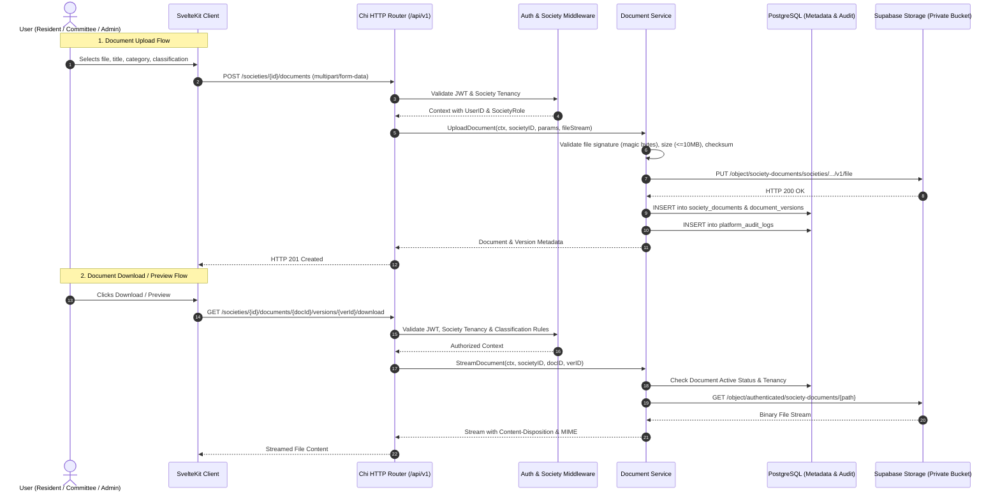

# 18 — Documents and Records Architecture

## 1. Overview & Purpose
Sprint S13 introduces official document repository capabilities into the CHS multi-tenant platform. Societies require secure, auditable, and categorized storage for bylaws, general body meeting minutes, audit reports, fire-safety compliance, and maintenance contracts.

The architecture emphasizes:
- Private object storage via Supabase Storage.
- Strict multi-tenant isolation and role-based access control (`SOCIETY_RESIDENTS`, `COMMITTEE`, `SOC_ADMIN_ONLY`).
- Magic-byte file validation, cryptographic checksums, and streaming transfers.
- Append-only version history.
- Audit logging for all creation, mutation, archival, and access events.

---

## 2. System Topology and Request Flow

---

## 3. Data Model Design

### 3.1 Document Categories (`document_categories`)
Categories group records into standard operational domains (e.g., *Registration & Legal*, *Bylaws & Rules*, *Meetings & Minutes*, *Financial Records*).
- `id` (UUID, PK)
- `society_id` (UUID, FK -> societies)
- `name` (TEXT, NOT NULL)
- `description` (TEXT)
- `is_system` (BOOLEAN, default false)
- `is_active` (BOOLEAN, default true)
- `display_order` (INT, default 0)
- Constraint: `UNIQUE (society_id, name)`

### 3.2 Society Documents (`society_documents`)
The root entity representing an official record.
- `id` (UUID, PK)
- `society_id` (UUID, NOT NULL, FK -> societies)
- `category_id` (UUID, NOT NULL, FK -> document_categories)
- `document_number` (TEXT, NOT NULL, `DOC-SOC-YYYYMM-XXXXX`)
- `title` (TEXT, NOT NULL)
- `description` (TEXT)
- `classification` (TEXT, CHECK `SOCIETY_RESIDENTS`, `COMMITTEE`, `SOC_ADMIN_ONLY`)
- `status` (TEXT, CHECK `ACTIVE`, `ARCHIVED`)
- `current_version_id` (UUID, FK -> document_versions)
- Optional associations: `building_id`, `wing_id`, `unit_id`, `member_id`
- `created_by`, `updated_by` (UUID, FK -> users)
- `created_at`, `updated_at`, `archived_at`, `archived_by`, `archived_reason`

### 3.3 Document Versions (`document_versions`)
Append-only versions for every revision of a document.
- `id` (UUID, PK)
- `society_id` (UUID, NOT NULL)
- `document_id` (UUID, NOT NULL, FK -> society_documents)
- `version_number` (INT, NOT NULL, 1, 2, 3...)
- `storage_path` (TEXT, NOT NULL)
- `file_name` (TEXT, NOT NULL)
- `file_size` (BIGINT, NOT NULL)
- `mime_type` (TEXT, NOT NULL)
- `file_hash` (TEXT, NOT NULL, SHA-256)
- `change_summary` (TEXT)
- `uploaded_by` (UUID, NOT NULL, FK -> users)
- `created_at` (TIMESTAMPTZ, NOT NULL)
- Constraints:
  - `UNIQUE (document_id, version_number)`
  - `FOREIGN KEY (document_id, society_id) REFERENCES society_documents(id, society_id)`

---

## 4. Security & Access Control

### 4.1 Tenant Boundary Isolation
All operations validate that the document, category, version, and optional physical associations belong strictly to `society_id`. Cross-society lookups fail with `404 Not Found` or `403 Forbidden` to prevent enumeration and IDOR vulnerabilities.

### 4.2 Role-Based Classification Resolution
| Classification | Accessible Roles |
| :--- | :--- |
| `SOCIETY_RESIDENTS` | Active Residents (`unit_relationships`), Committee Members, `SOC_ADMIN`, `SUPER_ADMIN` |
| `COMMITTEE` | Active Committee Members (`society_committee_appointments`), `SOC_ADMIN`, `SUPER_ADMIN` |
| `SOC_ADMIN_ONLY` | Assigned Society Admins (`society_user_roles`), Platform `SUPER_ADMIN` |

### 4.3 Storage Security
- Private bucket: `society-documents` has `public = false`.
- Direct unauthenticated URL access is rejected with `404 NoSuchBucket` or `403 AccessDenied`.
- Downloads are served only through the authorized Go API streaming endpoint.
- File integrity verified on upload using SHA-256 hash calculated on exact stored bytes.
- HTTP security headers: `X-Content-Type-Options: nosniff` and sanitization on `Content-Disposition`.

---

## 5. File Validation & Optimization Engine
The backend performs strict validation and type-aware optimization before writing to storage:
1. **Input Size Check**: Hard ceiling of 10 MB (10,485,760 bytes) on client selection and streaming reader.
2. **Signature Sniffing**: Inspects magic byte signatures:
   - PDF: `%PDF-` header
   - JPEG: `\xFF\xD8\xFF` header
   - PNG: `\x89PNG\r\n\x1a\n` header
   - WebP: `RIFF....WEBP` header
   - DOCX / XLSX: Zip container header `PK\x03\x04`
3. **MIME / Extension Matching**: File extension must strictly match detected MIME type.
4. **Safe Type-Aware Optimization**:
   - PNG: Lossless re-encoding using standard library `png.BestCompression` preserving alpha channels and pixel dimensions. Retains original bytes if optimization does not decrease byte count.
   - PDF, JPEG, WebP, DOCX, XLSX: Retains original bytes without destructive recompression or quality loss.
5. **Stored Artifact Size Limit**: Final stored artifact must be <= 5 MB (5,242,880 bytes).
6. **Checksum Calculation**: SHA-256 computed on the exact stored bytes post-optimization.
7. **Sanitized Name**: Strip path traversal and control characters via `SanitizeFilename`.

---

## 6. Version Lifecycle & Concurrency Control
- Append-only version history preserves all prior artifacts with their immutable SHA-256 digests.
- **Maximum Version Ceiling**: Capped at 20 versions per document (`MaxDocumentVersions = 20`).
- **Concurrency Safety**:
  - PostgreSQL row-level lock `SELECT ... FOR UPDATE` on `society_documents` prevents race conditions when allocating sequential version numbers.
  - Database trigger `trg_enforce_document_version_limit` guarantees engine-level integrity.
- **Compensatory Cleanup**: Storage uploads followed by unexpected database commit failures automatically trigger immediate deletion from storage to prevent orphaned files.

---

## 7. Storage Observability & Metrics
The metrics endpoint `GET /api/v1/societies/{id}/documents/metrics` provides non-sensitive aggregated storage statistics derived directly from PostgreSQL metadata:
- `total_documents`: Total distinct documents created in the society.
- `active_documents`: Currently active records.
- `archived_documents`: Deactivated records preserved for compliance.
- `total_versions`: Total committed version revisions.
- `total_stored_bytes`: Metadata-derived expected storage byte sum across all committed document versions (`SUM(v.file_size)` in PostgreSQL). This metric reflects the application's committed document footprint and does not poll physical cloud bucket storage or claim byte-for-byte equivalence with underlying storage infrastructure objects.
- **Batch Policy**: Single-file per document/version is currently active. Any 5-file / 25 MiB batch policy is a reserved architectural roadmap concept for future releases.

---

## 8. Audit Trail Integration
Every mutation writes an immutable row to `platform_audit_logs`:
- `DOCUMENT_CREATED`
- `DOCUMENT_METADATA_UPDATED`
- `DOCUMENT_VERSION_UPLOADED`
- `DOCUMENT_ARCHIVED`
- `DOCUMENT_RESTORED`
- `DOCUMENT_DOWNLOADED` (for sensitive categories / classifications)
- `DOCUMENT_CATEGORY_CREATED` / `DOCUMENT_CATEGORY_UPDATED`
