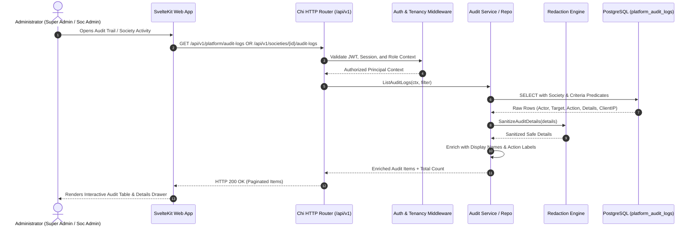

# 19 — Audit and Administration Architecture

## 1. Overview & Objectives
Sprint S14 delivers a unified, immutable, and high-performance audit and administrative inspection capability across the CHS platform.

Key architectural goals:
- **Unified Ledger**: Single append-only PostgreSQL table (`platform_audit_logs`) supporting both global platform administrative events and tenant-scoped society activity.
- **Strict Multi-Tenant Scoping**: Society administrators (`SOC_ADMIN`) can inspect only operations relevant to their assigned society. Cross-society leakages and IDOR vectors are eliminated at the database query layer.
- **Data Preservation**: Absolute preservation of existing 3,360+ audit rows without rewrites, truncations, or trigger disabling.
- **Safe Metadata Redaction**: Automatic, recursive server-side redaction of credentials, auth tokens, session secrets, and unmasked PII.
- **Rich Observability**: Enriched event representations including actor display names, masked contact details, human-friendly action labels, and structured metadata.

---

## 2. System Topology and Request Flow



---

## 3. Data Model Design & Dual Scoping

### 3.1 `platform_audit_logs` Schema
```text
┌────────────────────────────────────────────────────────┐
│                  platform_audit_logs                   │
├────────────────────────────────────────────────────────┤
│ id                 UUID PRIMARY KEY                    │
│ actor_id           UUID NOT NULL REFERENCES users(id)  │
│ action             TEXT NOT NULL                       │
│ target_user_id     UUID REFERENCES users(id)           │
│ society_id         UUID REFERENCES societies(id) (NEW) │
│ details            JSONB NOT NULL DEFAULT '{}'         │
│ client_ip          TEXT                                │
│ user_agent         TEXT                                │
│ created_at         TIMESTAMPTZ NOT NULL DEFAULT NOW()  │
└────────────────────────────────────────────────────────┘
```

### 3.2 Hybrid Society Scoping Strategy
- Historical records store society context as `details->>'society_id'`.
- New records populate the explicit `society_id` column as well as `details->'society_id'`.
- Society queries execute the index-backed union:
  ```sql
  WHERE (society_id = $1 OR details->>'society_id' = $1::text)
  ```
- Dual B-tree indexes guarantee fast execution without scanning irrelevant rows:
  - `idx_platform_audit_logs_society_id` on `(society_id, created_at DESC)`
  - `idx_platform_audit_logs_details_society` on `((details->>'society_id'), created_at DESC)`

---

## 4. Metadata Redaction Engine

Audit details must never leak authentication secrets or raw credential material. The backend applies recursive sanitization before sending data to clients:

```text
Incoming Details JSONB
       │
       ▼
Recursive Walk (Maps & Arrays)
       ├── Key contains "token", "password", "secret", "otp", "jwt", "key", "auth" ──► Value = "[REDACTED]"
       ├── Key is "phone" or "mobile" ──► Value = auth.MaskPhone(value)
       ├── Nested Map / Object ──► Recurse on children
       ├── Array / Slice ──► Recurse on elements
       └── Safe string / number / bool ──► Retain value
       │
       ▼
Safe Redacted Details Response
```

---

## 5. Action Catalogue & Coverage Matrix

Every subsystem in CHS emits structured audit logs. The audit catalog maps each action code to its source module, domain entity, and human-readable label:

| Module | Canonical Action Code | Human Label | Scoping |
| :--- | :--- | :--- | :--- |
| **Identity & Platform** | `SUPER_ADMIN_BOOTSTRAPPED` | Super Admin Initialized | Platform |
| | `ADMIN_CREATED` | Platform Admin Created | Platform |
| | `ADMIN_DISABLED` | Platform Admin Disabled | Platform |
| | `ADMIN_REACTIVATED` | Platform Admin Reactivated | Platform |
| **Society Lifecycle** | `SOCIETY_CREATED` | Society Created | Society |
| | `SOCIETY_ACTIVATED` | Society Activated | Society |
| | `SOCIETY_SUSPENDED` | Society Suspended | Society |
| | `SOCIETY_REACTIVATED` | Society Reactivated | Society |
| | `SOCIETY_ADMIN_ASSIGNED` | Society Admin Assigned | Society |
| | `SOCIETY_ADMIN_REVOKED` | Society Admin Revoked | Society |
| | `SOCIETY_PROFILE_UPDATED` | Society Profile Updated | Society |
| **Structure** | `BUILDING_CREATED` | Building Added | Society |
| | `WING_CREATED` | Wing Added | Society |
| | `UNITS_GENERATED` | Units Generated | Society |
| **Members & Roles** | `MEMBER_REGISTERED` | Member Registered | Society |
| | `MEMBER_DEPARTED` | Member Departed | Society |
| | `UNIT_RELATIONSHIP_CREATED` | Unit Relationship Created | Society |
| | `UNIT_RELATIONSHIP_ENDED` | Unit Relationship Terminated | Society |
| | `COMMITTEE_APPOINTMENT_CREATED`| Committee Member Appointed | Society |
| | `COMMITTEE_APPOINTMENT_ENDED` | Committee Appointment Ended | Society |
| | `DESIGNATION_CREATED` | Designation Created | Society |
| | `DESIGNATION_UPDATED` | Designation Updated | Society |
| | `DESIGNATION_STATUS_CHANGED` | Designation Status Changed | Society |
| **Gate Operations** | `GATE_CREATED` | Gate Added | Society |
| | `GATE_UPDATED` | Gate Updated | Society |
| | `GATEKEEPER_ASSIGNED` | Gatekeeper Assigned | Society |
| | `GATEKEEPER_REVOKED` | Gatekeeper Revoked | Society |
| | `GATE_DUTY_STARTED` | Gatekeeper Shift Started | Society |
| | `GATE_DUTY_ENDED` | Gatekeeper Shift Ended | Society |
| | `SHIFT_CREATED` | Gate Shift Configured | Society |
| | `STAFFING_REQUIREMENTS_UPDATED`| Staffing Requirements Updated | Society |
| **Visitor Management** | `VISIT_REGISTERED` | Pre-Approved Visit Created | Society |
| | `WALK_IN_REGISTERED` | Walk-in Visitor Registered | Society |
| | `VISITOR_CHECKED_IN` | Visitor Checked In | Society |
| | `VISITOR_CHECKED_OUT` | Visitor Checked Out | Society |
| | `VISIT_APPROVED` | Visit Approved by Resident | Society |
| | `VISIT_REJECTED` | Visit Rejected by Resident | Society |
| | `VISITOR_PASS_ISSUED` | Visitor Digital Pass Issued | Society |
| | `UNIT_VISITOR_POLICY_UPDATED` | Unit Visitor Policy Updated | Society |
| **Communication** | `ANNOUNCEMENT_CREATED` | Announcement Drafted | Society |
| | `ANNOUNCEMENT_PUBLISHED` | Announcement Published | Society |
| | `ANNOUNCEMENT_UPDATED` | Announcement Updated | Society |
| | `ANNOUNCEMENT_ARCHIVED` | Announcement Archived | Society |
| **Maintenance & Billing** | `CHARGE_CATEGORY_CREATED` | Charge Category Created | Society |
| | `CHARGE_CATEGORY_UPDATED` | Charge Category Updated | Society |
| | `CHARGE_CONFIG_CREATED` | Charge Config Created | Society |
| | `CHARGE_CONFIG_DEACTIVATED` | Charge Config Deactivated | Society |
| | `BILLING_PERIOD_CREATED` | Billing Period Created | Society |
| | `BILLS_GENERATED` | Maintenance Bills Generated | Society |
| | `BILL_VOIDED` | Maintenance Bill Voided | Society |
| | `MAINTENANCE_PAYMENT_RECORDED` | Maintenance Payment Recorded | Society |
| | `MAINTENANCE_PAYMENT_REVERSED` | Maintenance Payment Reversed | Society |
| **Documents & Records** | `DOCUMENT_CREATED` | Document Created | Society |
| | `DOCUMENT_VERSION_UPLOADED` | Document Version Uploaded | Society |
| | `DOCUMENT_CATEGORY_CREATED` | Document Category Created | Society |
| | `DOCUMENT_ARCHIVED` | Document Archived | Society |
| | `DOCUMENT_RESTORED` | Document Restored | Society |
| | `DOCUMENT_DOWNLOADED` | Sensitive Document Downloaded | Society |

---

## 6. Server-Side Pagination and Filtering
- **Deterministic Order**: `ORDER BY created_at DESC, id DESC` eliminates nondeterministic row skipping.
- **Bounded Page Size**: Defaults to 50 items; hard ceiling of 200 items per request.
- **Server-Side Filters**:
  - `start_date` and `end_date` mapped to `created_at >= $X AND created_at <= $Y`.
  - `action`: Exact equality filter on `action`.
  - `actor_id`: Exact UUID match on `actor_id`.
  - `target_user_id`: Exact UUID match on `target_user_id`.
  - `search`: Case-insensitive pattern match across action, details, client IP, and actor phone.

---

## 7. Frontend Integration
1. **Platform Audit Console (`/admin` Audit Trail tab)**:
   - Filter bar: action dropdown, actor/date inputs, search text, reset button.
   - Event table: Timestamp, Action Badge, Actor (Name/Phone), Target, Society Name, Client IP.
   - Detail drawer: Shows formatted metadata JSON, correlation info, and redacted fields.
2. **Society Audit Console (`/society/[id]` #audit tab)**:
   - Scoped strictly to the active society ID.
   - Integrated into the existing society navigation drawer.
   - Automatically re-fetches when switching societies; caches are scoped by `societyId`.

---

## 8. Immutability & Trust Boundaries
- **Application Level**: The API exposes read-only endpoints (`GET`). There are no `POST`, `PUT`, `PATCH`, or `DELETE` endpoints for existing audit records.
- **Database Level**: Active trigger `platform_audit_logs_immutability_trg` intercepts and rejects any `UPDATE` or `DELETE` with PostgreSQL exception `P0001`.
- **Infrastructure Boundary**: Direct superuser SQL access by infrastructure operators remains the only vector capable of modifying the table. Within the application tier, logs are strictly append-only.

## Related Documentation
- [[../decisions/028-audit-and-administration|ADR 028: Audit & Administration Architecture]]
- [[../database/14-audit-and-administration-schema|Database Schema 14: Audit & Administration]]
- [[../api/15-audit-and-administration-api|API 15: Audit & Administration Contracts]]
- [[../security/14-audit-and-administration-security|Security 14: Audit & Administration Security]]
- [[../sprints/S14-audit-and-administration|Sprint S14 Tracker]]
